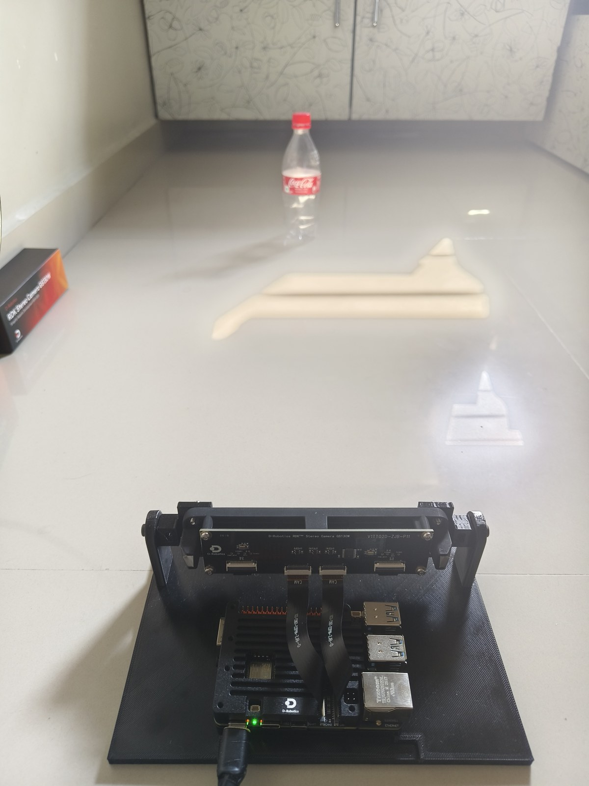
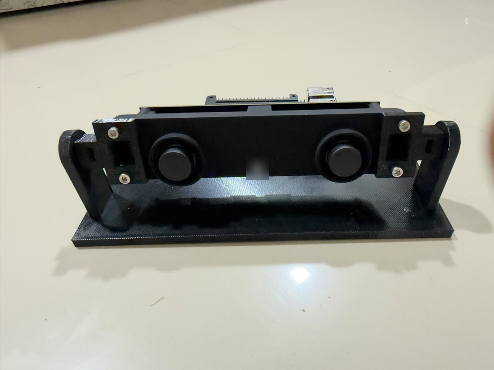
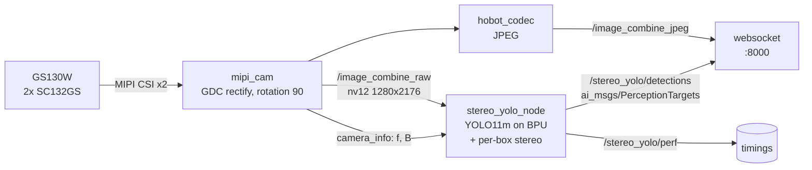
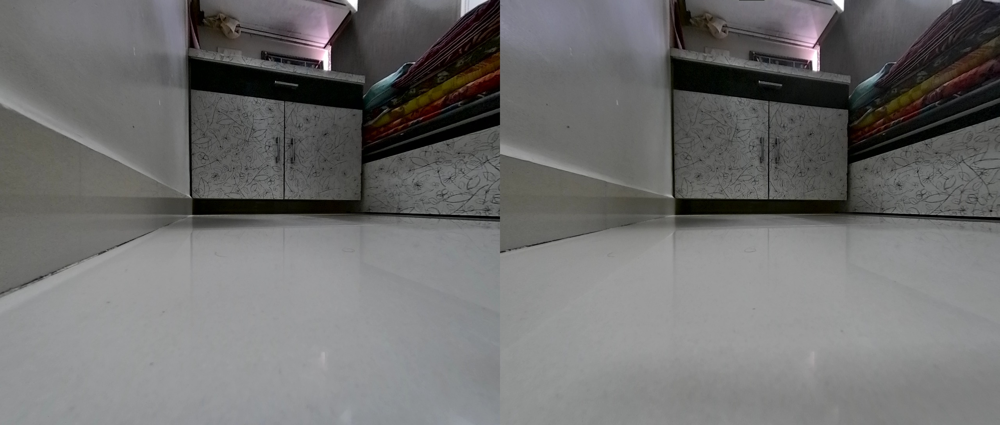

# RDK X5 Stereo YOLO: object detection with metric distance on the BPU

**Robotics Dream Keeper Challenge (Winter 2026), Stage 1.** RDK X5 (4 GB) + RDK Stereo Camera GS130W.

Every detected object gets a distance in metres, measured on the board from the stereo pair and checked against a
tape measure. The detector runs on the BPU. The distance comes from plain stereo geometry (no second network), so
this is still exactly one on-device AI task.


| Test setup | Camera stand (3D-printed, adjustable tilt) |
|---|---|
|  |   |

The floor tiles are 60 cm, so a tile line gives a quick distance reference: 1 tile = 0.6 m, 2 = 1.2 m, 3 = 1.8 m.

| What | Result (measured on my board) |
|---|---|
| Detector | YOLO11m (D-Robotics model zoo, Bayes-e build) on the BPU, 640x640 NV12 |
| Distance | Per box: NCC patch matching along the row in the rectified right image, sub-pixel, median; Z = f·B / d |
| Accuracy | 60 cm box → **60.9 cm** (+1.5 %); 60 cm cup → **60.4 cm**; 30 cm transparent bottle → **30.0–31.5 cm** |
| Calibration | Factory EEPROM calibration read by `mipi_cam`, rectified in GDC hardware; baseline **80.02 mm**, f 501.8 px |
| Live rate | 5.4–6.2 fps end to end with one object in view (Python node, see [Performance](#performance)) |

## Why this is not the stock demo

| | Stock YOLO demo | This project |
|---|---|---|
| Camera use | One eye of the stereo pair | Both eyes, rectified pair |
| Output | Class + box | Class + box + **distance in metres** per object |
| Accuracy | Not measured | **Checked against a tape measure** (table below) |
| Calibration | Hidden | Factory values read out and verified (row alignment, baseline) |
| Stock-stack problems | — | **10 issues found and documented**, 4 worked around in code ([UPSTREAM_ISSUES.md](UPSTREAM_ISSUES.md)) |
| Tests | — | Synthetic unit tests for stereo matching, YOLO decode, NMS, letterbox |

## Hardware and software

| Item | Version / detail |
|---|---|
| Board | RDK X5, 4 GB (3.0 GiB visible to Linux; the rest is ION/BPU carve-out) |
| OS image | `rdk-x5-ubuntu22-preinstalled-server-3.5.0-arm64.img.xz`, md5 `ec3aac7fff7ccd807d1e23a04edd115b` |
| Kernel / ROS | 6.1.83, ROS 2 Humble, TogetheROS `tros-humble` 2.5.2 |
| Camera | RDK Stereo Camera GS130W: 2x SC132GS global shutter, 1280x1088, MIPI CSI-2 on both camera ports |
| Power | 5 V / 5 A USB-C |
| Mount | Own 3D-printed stand: board on a base plate, camera on two arms with a tilt pivot |
| Network | Wi-Fi 5 GHz, SSH from an Ubuntu laptop |

## Setup

1. **Flash.** Write the 3.5.0 server image to a microSD card. I wrote the raw image with `xz -dc … | sudo dd of=/dev/sdX bs=4M conv=fsync`
   from Linux. This writes the same raw image as balenaEtcher, which the official docs list. Check the md5 first.
   Optional: add a NetworkManager keyfile in `/etc/NetworkManager/system-connections/` (root-owned, mode 600) so Wi-Fi works on first boot.
2. **Boot and log in** (`sunrise` / `sunrise`). The first boot grows the root partition to the full card. The green LED
   stays on even after boot has finished, so check over serial (micro-USB, 115200 baud) or the network instead.
3. **Connect the camera with the board powered off.** GS130W orientation (from the accessory docs):
   - camera end: cable contacts face **away from** the camera PCB;
   - board end: contacts face **toward the Ethernet port**.

   The GS130W**i** is the opposite. Check the I2C addresses:
   ```bash
   sudo i2cdetect -y -r 6 0x30 0x33   # port next to Ethernet -> 33
   sudo i2cdetect -y -r 4 0x30 0x33   # other port           -> 32
   ```
4. **Get the code** onto the board (no build step):
   ```bash
   git clone <this repo> ~/stage1
   ```

Dependencies are all on the stock image: `tros-humble` (`mipi_cam`, `hobot_codec`, `websocket`, `hobot_shm`, `ai_msgs`),
`hbm_runtime`, OpenCV 4.11, NumPy, and `hobot-sp-samples` (`/app/pydev_demo`: models and helpers).

## Run

```bash
source /opt/tros/humble/setup.bash
ros2 launch ~/stage1/stereo_yolo.launch.py          # optional: fps:=15.0
```

Open `http://<board-ip>:8000` and click the web display. The left camera is on top; boxes are labelled `<class> <distance>m`, with
`distance_m`, `disparity_px`, `disparity_iqr_px` and `patches` as attributes. The node logs a summary every 30 frames:

```
[stereo_yolo]: 5.8 fps | yolo 71.7 ms, stereo 84.2 ms, total 156.1 ms, frame age 227 ms, objects 1.0 | bottle 0.30m
```

Stop with Ctrl+C. If a camera launch then fails with `ret -217` or `There are no available host`, an old `mipi_cam` is still
holding the camera: `pkill -f "[m]ipi_cam"` and launch again.

### ROS 2 graph



### Files

| File | Purpose |
|---|---|
| `stereo_yolo.launch.py` | Camera (rotation 90, realtime stamps), JPEG encoder, web viewer, node |
| `stereo_yolo_node.py` | ROS 2 node: BPU inference, decode, per-box distance, `ai_msgs` output, timings |
| `stereo_geom.py` | Pure functions (no ROS, no BPU): NV12 letterbox, YOLOv8/11 head decode with per-channel dequant, NMS, `box_disparity` |
| `tests/test_stereo_geom.py` | Synthetic checks: sub-pixel disparity 12–216 px within 0.25 px (measured within 0.03 px), decode, dequant, NMS, letterbox |
| `deploy.sh` | Laptop → board copy of the committed tree (no `.git` on the robot) |
| `UPSTREAM_ISSUES.md` | Problems found in the stock stack, with evidence and suggested fixes |

## Results

### Calibration (read from the GS130W EEPROM by `mipi_cam`)

| Quantity | Left | Right |
|---|---|---|
| Raw fx / fy (1280x1088) | 665.01 / 664.88 | 664.76 / 665.03 |
| Raw cx / cy | 640.96 / 542.24 | 638.15 / 542.65 |
| Translation R→L | (-80.019, 0.106, 0.137) mm, baseline **80.02 mm** | |
| Rectified (rotation 90) | f 501.797 px, cx 640.748, cy 542.520 | P[3] = -40153.5 px·mm |
| Row alignment after rectification | 83 % of 161 textured patches within ±1 px vertically | |

This also settles the GS130W baseline question raised on the forum (80 mm from the datasheet vs "about 12 cm"): the EEPROM says 80.02 mm.



### Distance accuracy (tape measure from the camera front, planar Z from the left lens)

| Object | True | Measured | Error | Notes |
|---|---|---|---|---|
| RDK X5 box | 60 cm | 60.9 cm | +0.9 cm (+1.5 %) | 5 frames, sd 0.00 px; laptop analysis of board frames |
| Cup | 60 cm | 60.4 cm | +0.4 cm | YOLO11m box, final settings |
| Coca-Cola bottle | 60 cm | 59–62 cm | ≤ 2 cm | live, across matcher settings |
| Transparent bottle | 30 cm | 30.0–31.5 cm | ≤ 1.5 cm | live; background shows through, IQR 9–15 px |
| Three boxes (no tape) | — | 18.6 / 27.0 / 18.5 cm | — | NCC and OpenCV SGBM agree within 3 mm |

Part of the positive bias is probably the reference point: the tape starts at the camera front, while Z starts at the
lens optical centre a few mm inside. Expected resolution at f·B = 40.15 px·m: one pixel of disparity is ≈ 0.9 cm at 0.6 m,
2.5 cm at 1 m and 10 cm at 2 m. Not yet measured beyond 60 cm.


### BPU benchmarks (`hrt_model_exec perf`, 200 frames, BPU only)

| Model (640x640) | 1 thread | 2 threads |
|---|---|---|
| YOLOv8n | 12.1 ms, 82 FPS | 169 FPS |
| YOLOv12n (Bayes-e) | 27.6 ms, 36 FPS | 53 FPS |
| YOLOv5s v7 | 33.2 ms, 30 FPS | 65 FPS |
| YOLO11m (Bayes-e) | 40.5 ms, 25 FPS | 31 FPS |
| YOLOv10 | 52.2 ms, 19 FPS | 59 FPS |

YOLOv8n is the fastest, but it missed a small white cup at 60 cm (score < 0.05). YOLO11m scored it 0.31 with a tight
box, so YOLO11m is the default (`model` parameter to change).

### Performance

Live, with one object in view; camera, JPEG encoder, web viewer and node all on the board (load average ~4.7):

| Stage | Time |
|---|---|
| YOLO11m incl. letterbox + decode (Python) | 72–76 ms |
| Stereo distance, one box (49 patches) | 80–86 ms |
| Total per frame | 152–160 ms |
| End-to-end rate | 5.4–5.8 fps (6.0–6.2 fps with a 5x5 patch grid, but that grid failed on the transparent bottle) |
| Frame age at publish (capture → result) | 224–236 ms |

What I measured while optimising (profiled on the board):

| Step | Stock helper | This repo |
|---|---|---|
| Letterbox 1280x1088 → 640x640 | 25.5 ms (BGR round trip) | ~1 ms (NV12 strided copy into a reused buffer) |
| YOLO head decode | 11.9 ms + 7.1 ms filter | rows above threshold only, OpenCV NMS |
| Stereo, big box | 890 ms (dense grid) | 80 ms (fixed 7x7 grid) |

The remaining cost is Python: each 4 MB stereo frame is copied into Python, and each small `matchTemplate` takes ~1.3 ms on the
busy A55 cores. The next step is a C++ node on the zero-copy (`hbmem`) transport.

## Troubleshooting (everything below happened on this board)

| Symptom | Cause | Fix |
|---|---|---|
| `i2c_designware 341d0000.i2c: controller timed out`, no sensor at 0x30–0x33 | Camera cable orientation (I first used the generic X5 rule "metal away from the latch") | Power off, reseat per the GS130W rule above. Then bus 6 → 0x33, bus 4 → 0x32 |
| Left/right shifted **vertically**, preview sideways, `camera_info` numbers look scrambled | EEPROM calibration angle is 90°; output turn = `mipi_rotation − 90`, default 0 → 270° | Launch with `mipi_rotation:=90.0` |
| `create_and_run_vflow(1590) failed, ret -217` / `There are no available host` | Another `mipi_cam` still owns the camera | `pkill -f "[m]ipi_cam"`, relaunch |
| Python subscriber gets no `/image_combine_raw` frames, no error | Started outside the launch (no `hobot_shm` env) or BEST_EFFORT QoS | Start from the launch file; RELIABLE, depth 1 |
| YOLOv8n boxes wrong with the sample helpers | `dequantize_tensor` skips `SCALE` (=2) outputs; int32 box heads stay raw | Per-channel dequant in `stereo_geom.decode_yolov8_level` |
| `ros2 topic echo` from a plain SSH shell: `error creating node` | CLI/daemon issue in that shell | The node logs a summary every 30 frames |
| `pkill -f name` kills the SSH command itself | The pattern matches its own command line | Use `pkill -f "[n]ame"`, or run the kill as a separate command |
| Websocket floods `cache image num > 100` | No matching AI message yet | Harmless; stops once the detector publishes |
| `rdkos_info` prints `Permission denied` | cpufreq files are root-only | `sudo rdkos_info` |

## Known limitations

- Transparent objects: the background shows through, so matches are fewer and noisier. A transparent bottle at 1 m was not
  detected at all (a YOLO limit for a small, low-contrast object).
- Textureless surfaces (white floor and walls) give no stereo matches. That's normal for passive stereo; the box median needs ≥ 5 textured patches.
- Only measured up to 60 cm; error grows with the square of distance.
- 5–7 fps in Python; not real time yet.
- No actuators. Nothing moves, so there are no safety limits to configure in Stage 1.

## Roadmap

- **Stage 2:** a C++ zero-copy node; a tape-measure table at 0.5/1/2/3 m with an error curve against the expected f·B/d²;
  hardware-in-the-loop with a Webots driving simulator on the laptop, where the board's distances are scored
  against simulator ground truth.
- **Upstream:** issues and pull requests for the problems in [UPSTREAM_ISSUES.md](UPSTREAM_ISSUES.md).

## Evidence

| Stage 1 item | File |
|---|---|
| Flash + SSH (OS 3.5.0, hardware model, BPU status) | [01_flash_ssh_rdkos_info.png](docs/images/01_flash_ssh_rdkos_info.png) |
| Sensor on MIPI (`sc132gs-1280p init success`, ~60 fps), internet ping | [02_camera_init_rate_internet.png](docs/images/02_camera_init_rate_internet.png) |
| Stereo preview served by the board | [03_stereo_preview_on_board.jpg](docs/images/03_stereo_preview_on_board.jpg) |
| AI task on the board with distance | [04_ai_bottle_30cm.jpg](docs/images/04_ai_bottle_30cm.jpg) |

## License

Apache-2.0 (see `LICENSE`).
