<div align="center">

# RDK X5 Stereo YOLO

**Object detection with a distance in metres for every box, running on the RDK X5 BPU**


[Results](#results) · [How it works](#how-it-works) · [Run it](#run-it) · [Troubleshooting](#troubleshooting) · [Stock-stack issues](UPSTREAM_ISSUES.md) · **[Stage 2 plan](#stage-2-stereo-hil)**

</div>

<table>
<tr>
<td width="50%"></td>
<td width="50%">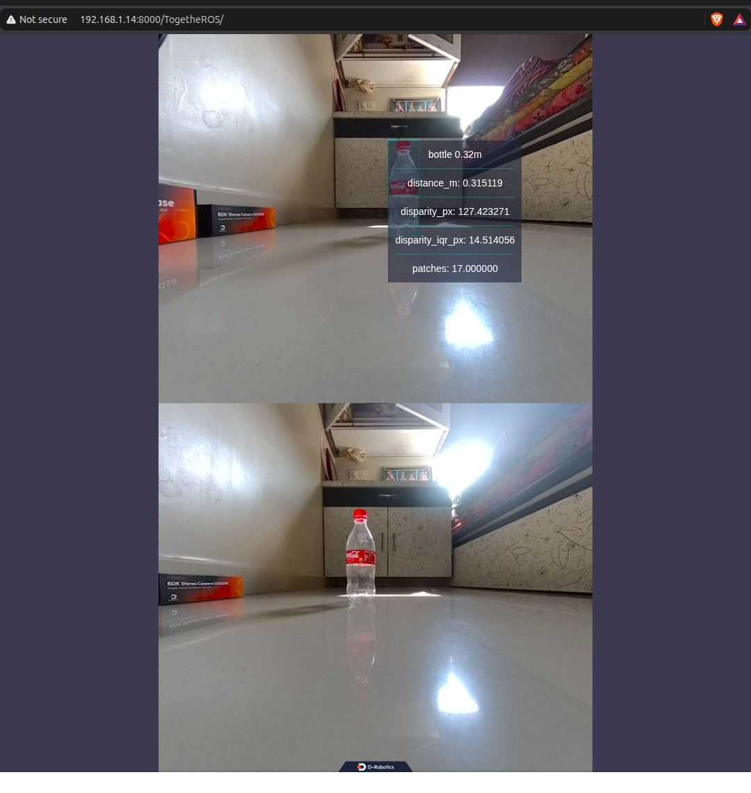</td>
</tr>
<tr>
<td align="center"><sub><b>The rig.</b> GS130W on my 3D-printed stand, bottle one floor tile (60 cm) ahead</sub></td>
<td align="center"><sub><b>The output.</b> Served by the board: <code>bottle 0.32m</code> for a bottle at 30 cm</sub></td>
</tr>
</table>

## At a glance

<table>
<tr>
<td align="center"><h3>+1.5 %</h3><sub>error at 60 cm<br>vs a tape measure</sub></td>
<td align="center"><h3>80.02 mm</h3><sub>baseline read from the<br>camera's EEPROM</sub></td>
<td align="center"><h3>1 AI task</h3><sub>YOLO11m on the BPU;<br>distance is pure geometry</sub></td>
<td align="center"><h3>10 issues</h3><sub>found in the stock stack,<br>4 worked around here</sub></td>
</tr>
</table>

Most YOLO demos use one eye of a stereo camera and stop at a box. Here **every detection gets a distance**, computed
on the board from the rectified stereo pair with the camera's own factory calibration, and **checked against a tape
measure**. The distance needs no second neural network, so the board still runs exactly one AI task.

| | Typical stock demo | This project |
|---|:---:|:---:|
| Uses both camera eyes | ❌ | ✅ |
| Distance per object | ❌ | ✅ metres, live |
| Accuracy checked against ground truth | ❌ | ✅ |
| Calibration read out and verified | ❌ | ✅ |
| Bugs in the stock stack found and documented | ❌ | ✅ [10](UPSTREAM_ISSUES.md) |
| Unit tests | ❌ | ✅ |

## Results

<picture>
  <source media="(prefers-color-scheme: dark)" srcset="docs/figures/accuracy_dark.png">
  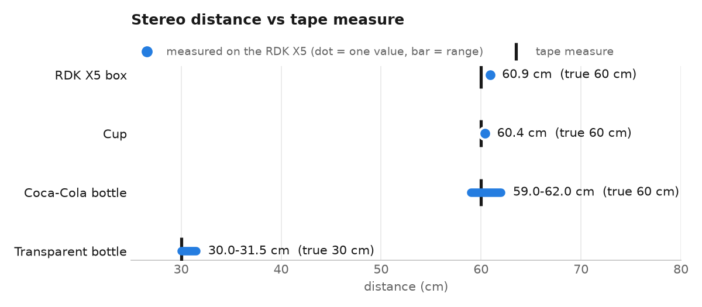
</picture>

<details>
<summary><b>Accuracy table and notes</b></summary>

| Object | True | Measured | Error | Notes |
|---|---|---|---|---|
| RDK X5 box | 60 cm | 60.9 cm | +0.9 cm (+1.5 %) | 5 frames, sd 0.00 px; board frames analysed on the laptop |
| Cup | 60 cm | 60.4 cm | +0.4 cm | YOLO11m box, final settings |
| Coca-Cola bottle | 60 cm | 59–62 cm | ≤ 2 cm | live, across matcher settings |
| Transparent bottle | 30 cm | 30.0–31.5 cm | ≤ 1.5 cm | live; background shows through, IQR 9–15 px |
| Three boxes (no tape) | — | 18.6 / 27.0 / 18.5 cm | — | NCC and OpenCV SGBM agree within 3 mm |

Part of the positive bias is probably the reference point: the tape starts at the camera front, while Z starts at the
lens optical centre a few mm inside. With f·B = 40.15 px·m, one pixel of disparity is ≈ 0.9 cm at 0.6 m, 2.5 cm at 1 m
and 10 cm at 2 m. Not yet measured beyond 60 cm.

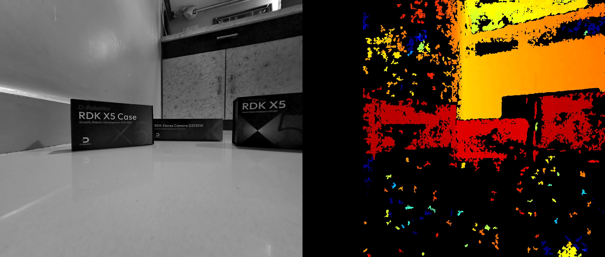

</details>

<picture>
  <source media="(prefers-color-scheme: dark)" srcset="docs/figures/bpu_dark.png">
  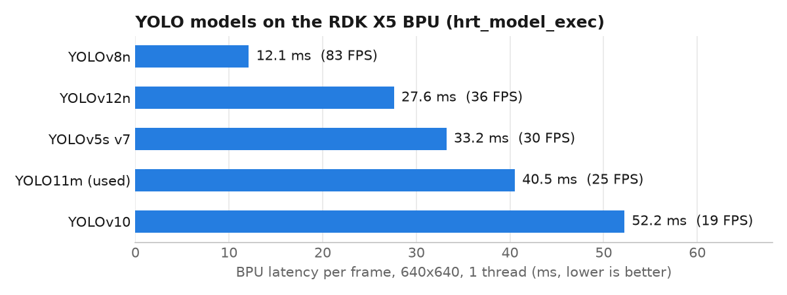
</picture>

<details>
<summary><b>Why YOLO11m and not the faster YOLOv8n?</b></summary>

YOLOv8n missed a small white cup at 60 cm (score < 0.05); YOLO11m scored it 0.31 with a tight box. With two BPU threads
the throughput is YOLOv8n 169 FPS, YOLOv12n 53, YOLOv5s 65, YOLO11m 31, YOLOv10 59 (`hrt_model_exec perf`, 200 frames,
BPU only, no pre/post-processing). Change the model with the node's `model` parameter.

</details>

<picture>
  <source media="(prefers-color-scheme: dark)" srcset="docs/figures/speedup_dark.png">
  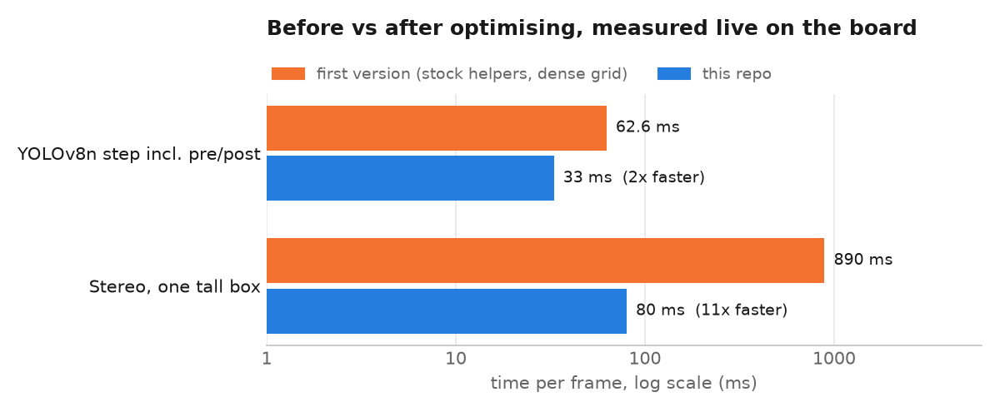
</picture>

<details>
<summary><b>Live timings of the current pipeline</b></summary>

Measured with one object in view; camera, JPEG encoder, web viewer and node all on the board (load average ~4.7).

| Stage | Time |
|---|---|
| YOLO11m incl. letterbox + decode (Python) | 72–76 ms |
| Stereo distance, one box (7x7 patches) | 80–86 ms |
| Total per frame | 152–160 ms |
| End-to-end rate | 5.4–5.8 fps |
| Frame age at publish (capture → result) | 224–236 ms |

Profiling on the board: the stock sample letterbox took 25.5 ms and the stock decode + filter 19 ms. The whole
YOLOv8n step went from 62.6 ms to about 33 ms after replacing both. The rest is Python: each 4 MB stereo frame is copied
into Python, and each small `matchTemplate` costs ~1.3 ms on the busy A55 cores. The next step is a C++ node on the
zero-copy (`hbmem`) transport.

</details>

## How it works

<picture>
  <source media="(prefers-color-scheme: dark)" srcset="docs/figures/architecture_dark.svg">
  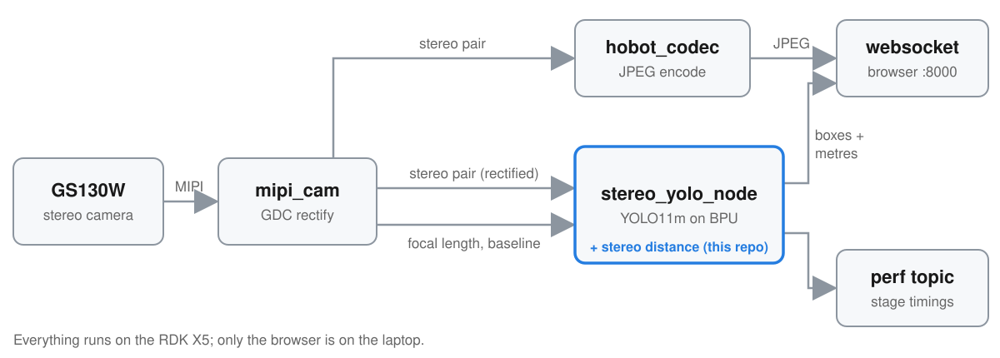
</picture>

1. **Rectify in hardware.** `mipi_cam` reads the GS130W's factory calibration from its EEPROM and rectifies both images
   in the GDC block. `mipi_rotation:=90.0` keeps the shift between the eyes horizontal ([why](#troubleshooting)).
2. **Detect on the BPU.** YOLO11m runs on the left image. My decoder dequantizes per channel and only touches the rows
   above the score threshold.
3. **Range each box.** Inside the middle of each box, a 7x7 grid of 15x15 patches is matched (NCC) along the same row in
   the right image, with a sub-pixel peak fit. The median disparity *d* gives **Z = f·B / d**, with f and B taken from
   `camera_info`.
4. **Publish.** `ai_msgs/PerceptionTargets` with the label `bottle 0.32m` and the attributes `distance_m`,
   `disparity_px`, `disparity_iqr_px` and `patches`. The stock web viewer draws them directly.

<details>
<summary><b>Calibration read from the GS130W EEPROM</b></summary>

| Quantity | Left | Right |
|---|---|---|
| Raw fx / fy (1280x1088) | 665.01 / 664.88 | 664.76 / 665.03 |
| Raw cx / cy | 640.96 / 542.24 | 638.15 / 542.65 |
| Translation R→L | (-80.019, 0.106, 0.137) mm, baseline **80.02 mm** | |
| Rectified (rotation 90) | f 501.797 px, cx 640.748, cy 542.520 | P[3] = -40153.5 px·mm |
| Row alignment after rectification | 83 % of 161 textured patches within ±1 px vertically | |

This also settles the GS130W baseline question raised on the D-Robotics forum (80 mm from the datasheet vs "about
12 cm"): the EEPROM says 80.02 mm.


</details>

<details>
<summary><b>Files in this repo</b></summary>

| File | Purpose |
|---|---|
| `stereo_yolo.launch.py` | Camera (rotation 90, realtime stamps), JPEG encoder, web viewer, node |
| `stereo_yolo_node.py` | ROS 2 node: BPU inference, decode, per-box distance, `ai_msgs` output, timings |
| `stereo_geom.py` | Pure functions (no ROS, no BPU): NV12 letterbox, YOLOv8/11 decode, NMS, `box_disparity` |
| `tests/test_stereo_geom.py` | Synthetic checks: sub-pixel disparity 12–216 px (measured within 0.03 px), decode, dequant, NMS, letterbox |
| `tools/make_figures.py` | Regenerates the charts and diagram in `docs/figures` (light and dark) |
| `deploy.sh` | Laptop → board copy of the committed tree (no `.git` on the robot) |
| `UPSTREAM_ISSUES.md` | Problems in the stock stack, with evidence, upstream file and line, and suggested fixes |

</details>

## Run it

```bash
# on the RDK X5 (RDK OS 3.5.0, TROS Humble); no build step needed
git clone https://github.com/omgajjar1976/rdk-x5-stereo-yolo ~/stage1
source /opt/tros/humble/setup.bash
ros2 launch ~/stage1/stereo_yolo.launch.py
```

Open **`http://<board-ip>:8000`** and click the web display. The node prints a summary every 30 frames:

```text
5.8 fps | yolo 71.7 ms, stereo 84.2 ms, total 156.1 ms, frame age 227 ms | bottle 0.30m
```

<details>
<summary><b>Full setup: flashing, Wi-Fi, camera cable, dependencies</b></summary>

| Item | Version / detail |
|---|---|
| Board | RDK X5, 4 GB (3.0 GiB visible to Linux; the rest is ION/BPU carve-out) |
| OS image | `rdk-x5-ubuntu22-preinstalled-server-3.5.0-arm64.img.xz`, md5 `ec3aac7fff7ccd807d1e23a04edd115b` |
| Kernel / ROS | 6.1.83, ROS 2 Humble, TogetheROS `tros-humble` 2.5.2 |
| Camera | RDK Stereo Camera GS130W: 2x SC132GS global shutter, 1280x1088, MIPI CSI-2 on both camera ports |
| Power | 5 V / 5 A USB-C |
| Mount | Own 3D-printed stand: board on a base plate, camera on two arms with a tilt pivot |

1. **Flash.** I wrote the raw image from Linux with `xz -dc … | sudo dd of=/dev/sdX bs=4M conv=fsync`. This writes the
   same image as balenaEtcher, which the official docs list. Check the md5 first.
   Optional: add a NetworkManager keyfile in `/etc/NetworkManager/system-connections/` (root, mode 600) so Wi-Fi works on first boot.
2. **Boot and log in** (`sunrise` / `sunrise`). The first boot grows the root partition to the full card. The green LED
   stays on even after boot, so check over serial (micro-USB, 115200 baud) or the network instead.
3. **Camera cable, board powered off.** GS130W rule (from the accessory docs):
   - camera end: contacts face **away from** the camera PCB;
   - board end: contacts face **toward the Ethernet port**.

   The GS130W**i** is the opposite. Check the sensors are detected:
   ```bash
   sudo i2cdetect -y -r 6 0x30 0x33   # port next to Ethernet -> 33
   sudo i2cdetect -y -r 4 0x30 0x33   # other port           -> 32
   ```
4. **Dependencies** are all on the stock image: `tros-humble` (`mipi_cam`, `hobot_codec`, `websocket`, `hobot_shm`,
   `ai_msgs`), `hbm_runtime`, OpenCV 4.11, NumPy, and `hobot-sp-samples` (`/app/pydev_demo` models and helpers).

|  | 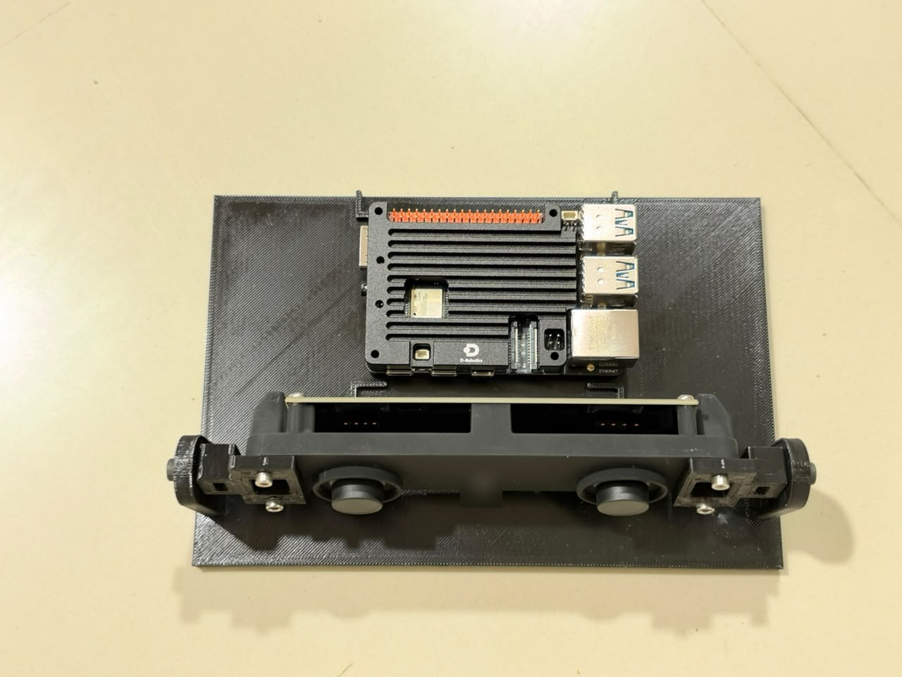 |
|---|---|
| <sub>Stand, front: both lenses</sub> | <sub>Stand, top: board behind the camera</sub> |

</details>

## Troubleshooting

Everything below happened on this board while building the project.

<details>
<summary><b>Camera not detected: <code>i2c_designware 341d0000.i2c: controller timed out</code></b></summary>

**Cause:** cable orientation. I first followed the generic X5 rule ("metal away from the latch").
**Fix:** power off and reseat using the GS130W rule (camera end away from the PCB, board end toward Ethernet). After that, bus 6 shows 0x33 and bus 4 shows 0x32.
</details>

<details>
<summary><b>Left/right shifted vertically, preview sideways, <code>camera_info</code> looks scrambled</b></summary>

**Cause:** the EEPROM stores a calibration angle of 90°. The driver turns the output by `mipi_rotation − 90`, and the default is 0, so the output is turned 270°.
**Fix:** launch with `mipi_rotation:=90.0`. The launch file in this repo does this.
</details>

<details>
<summary><b><code>create_and_run_vflow(1590) failed, ret -217</code> or <code>There are no available host</code></b></summary>

**Cause:** another `mipi_cam` still owns the camera. **Fix:** `pkill -f "[m]ipi_cam"`, then launch again.
</details>

<details>
<summary><b>A Python subscriber receives no <code>/image_combine_raw</code> frames, and no error</b></summary>

**Cause:** the node was started outside the launch (no `hobot_shm` environment), or with BEST_EFFORT QoS.
**Fix:** start it from the launch file, with RELIABLE QoS and depth 1.
</details>

<details>
<summary><b>YOLOv8n boxes are wrong with the sample helpers</b></summary>

**Cause:** `dequantize_tensor` skips `SCALE` (=2) outputs, so the int32 box heads stay raw.
**Fix:** per-channel dequant in `stereo_geom.decode_yolov8_level` ([issue 1](UPSTREAM_ISSUES.md)).
</details>

<details>
<summary><b>Smaller ones</b></summary>

| Symptom | Fix |
|---|---|
| `ros2 topic echo` from a plain SSH shell: `error creating node` | Read the node's 30-frame summary log instead |
| `pkill -f name` kills your own SSH command | Use `pkill -f "[n]ame"`, or run the kill as a separate command |
| Websocket floods `cache image num > 100` | Harmless; stops once the detector publishes |
| `rdkos_info` prints `Permission denied` | `sudo rdkos_info` |
| Transparent bottle at 30 cm showed `?m` | Fewer than 5 patches matched; now a 7x7 grid with NCC ≥ 0.75 |

</details>

## Stage 2: Stereo HIL

Next, the board drives a **simulated car**. Webots + SUMO on the laptop render a stereo pair with the GS130W's baseline and
field of view. The RDK X5 runs YOLO11m and StereoNet on the BPU, decides (adaptive cruise, emergency brake) and sends back
Ackermann commands. Every decision is scored against the simulator's pixel-exact ground truth.

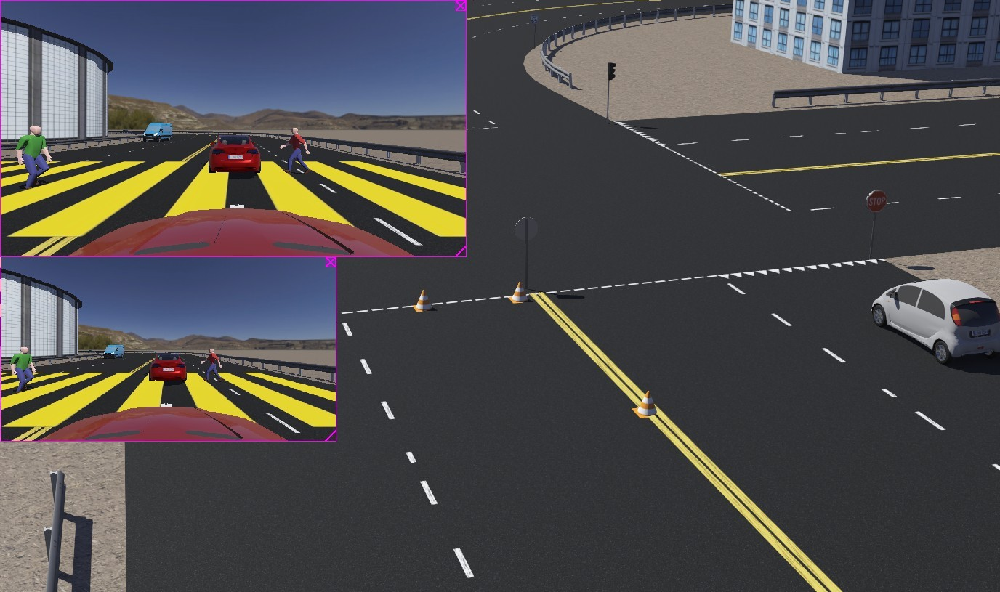

<picture>
  <source media="(prefers-color-scheme: dark)" srcset="docs/figures/hil_architecture_dark.svg">
  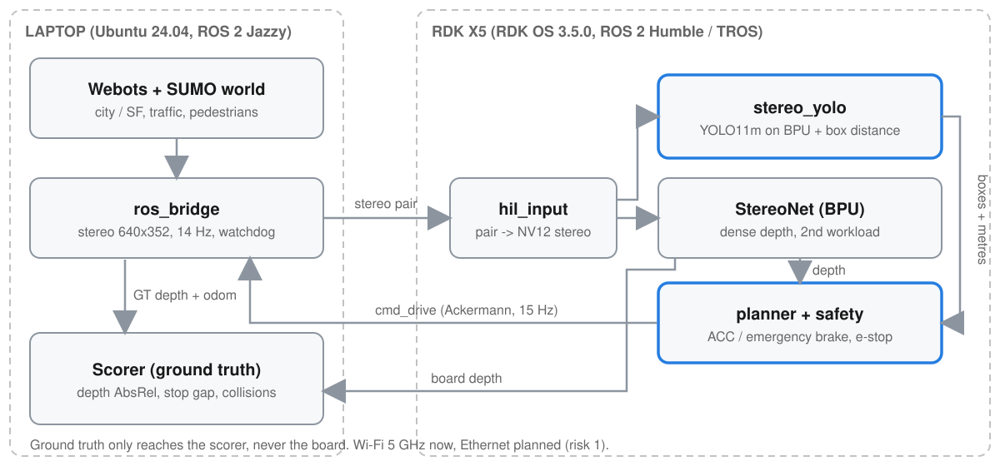
</picture>

<details>
<summary><b>The pedestrian-crossing scenario</b></summary>

Without the board in the loop, the scripted test car doesn't brake. In Stage 3 the board has to stop it.

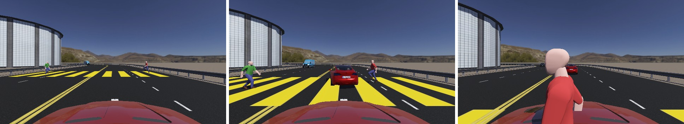

</details>

<details>
<summary><b>Ground truth: camera view and exact depth</b></summary>

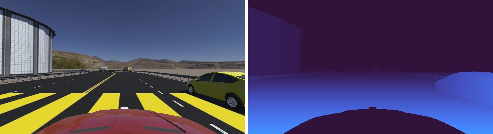

</details>

<details>
<summary><b>Second world: San Francisco streets</b></summary>

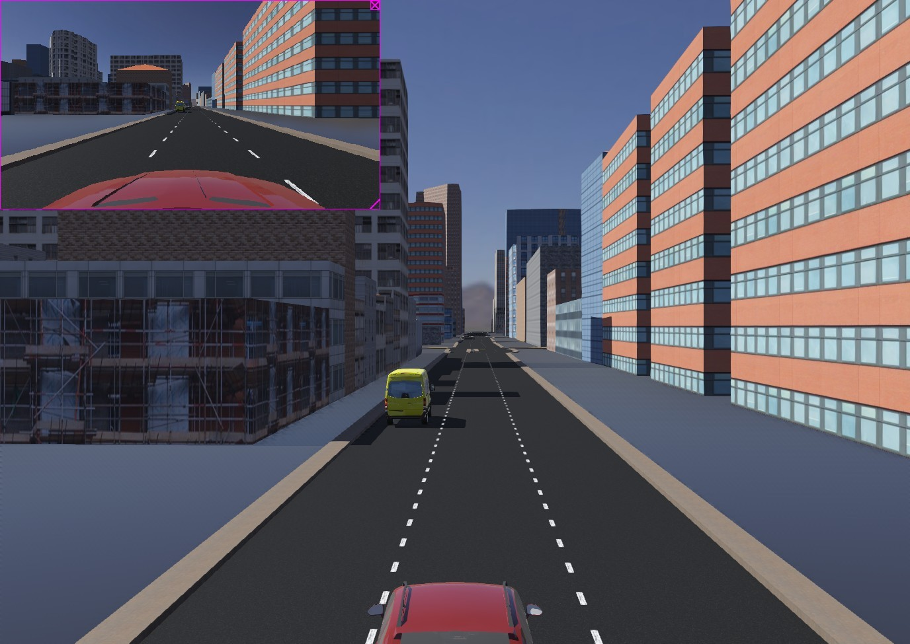

</details>

<details>
<summary><b>Decision logic</b></summary>

<picture>
  <source media="(prefers-color-scheme: dark)" srcset="docs/figures/decision_flow_dark.svg">
  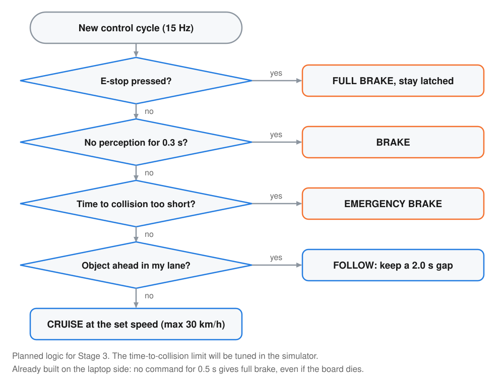
</picture>

</details>

| Document | Contents |
|---|---|
| [Proposal](docs/stage2/PROPOSAL.md) | Problem, users, capabilities, innovation vs prior art, 7 measurable targets |
| [Architecture](docs/stage2/ARCHITECTURE.md) | Data flow, module table with failure modes, BPU/CPU/laptop split, ROS 2 graph with types and rates |
| [Engineering plan](docs/stage2/ENGINEERING_PLAN.md) | BOM, top five risks (trigger, mitigation, fallback), repository structure |
| [Roadmap](ROADMAP.md) | Milestones to Dec 15, including the Dec 3 Mid-Point Showcase |

## Limitations and roadmap

- **Transparent or textureless objects** give fewer stereo matches. A transparent bottle at 1 m was not detected at all
  (a YOLO limit for a small, low-contrast object).
- **Measured only up to 60 cm** so far; the error grows with the square of the distance.
- **5–6 fps in Python.** Next: a C++ zero-copy node.
- **No actuators** in Stage 1, so nothing moves and there are no safety limits to configure.

**Next:** a tape-measure table at 1.2 / 1.8 / 2.4 m (floor tiles), then hardware-in-the-loop with a Webots driving
simulator, where the board's distances are scored against simulator ground truth. Upstream issues and PRs for
[the stock-stack problems](UPSTREAM_ISSUES.md).

## Stage 1 evidence

| Item | Evidence |
|---|---|
| Flash + SSH: OS 3.5.0, hardware model, BPU status | [01_flash_ssh_rdkos_info.png](docs/images/01_flash_ssh_rdkos_info.png) |
| Sensor on MIPI: `sc132gs-1280p init success`, ~60 fps; internet ping | [02_camera_init_rate_internet.png](docs/images/02_camera_init_rate_internet.png) |
| Stereo preview served by the board | [03_stereo_preview_on_board.jpg](docs/images/03_stereo_preview_on_board.jpg) |
| AI task on the board, with distance | [04_ai_bottle_30cm.jpg](docs/images/04_ai_bottle_30cm.jpg) |

## License

Apache-2.0, see [LICENSE](LICENSE).
