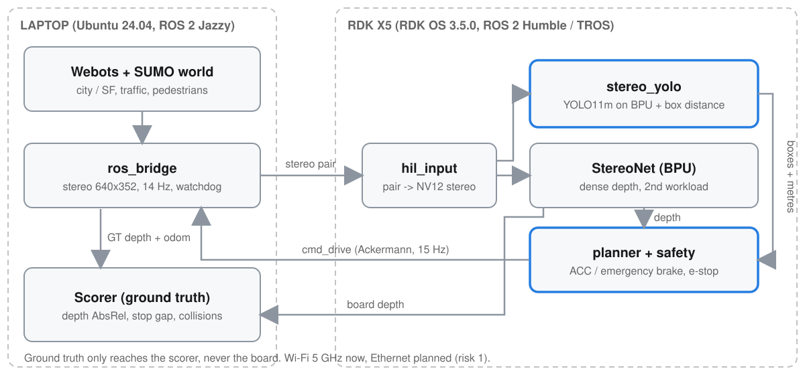
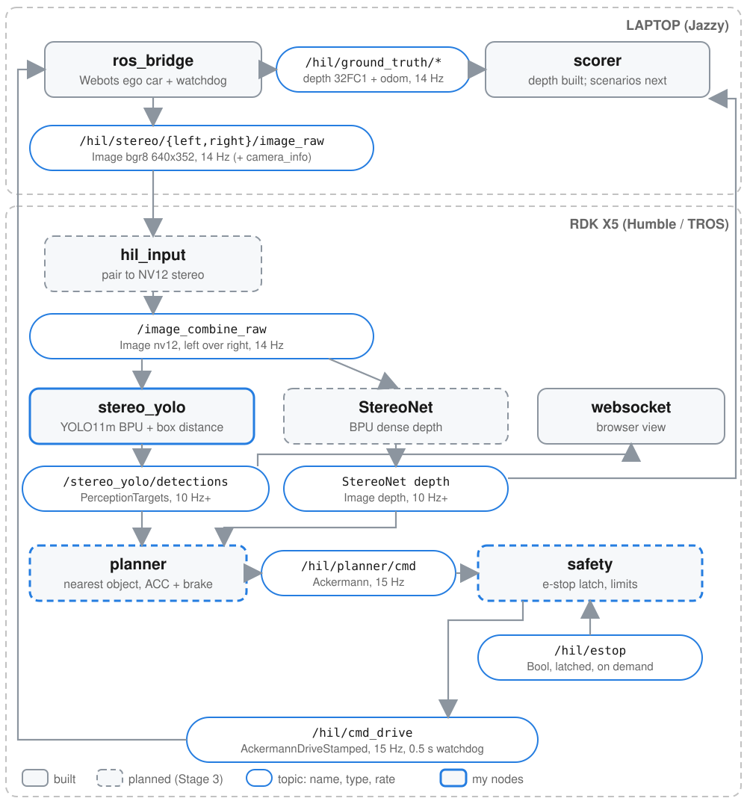
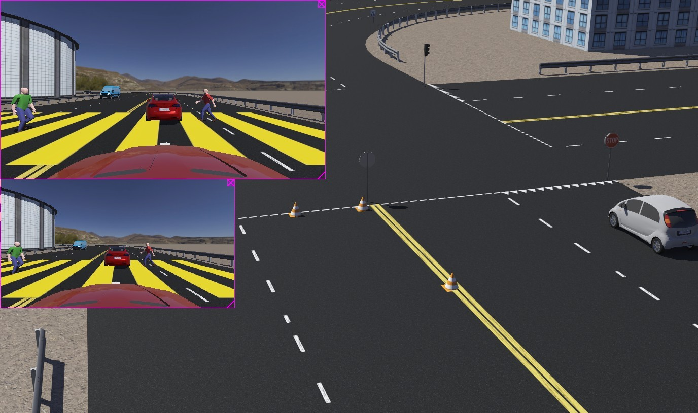
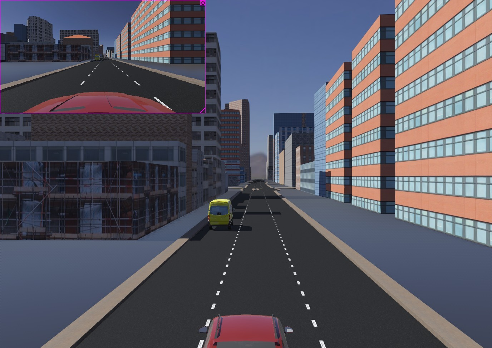

# Parallax: Stage 2 architecture

## Data flow

<picture>
  <source media="(prefers-color-scheme: dark)" srcset="../figures/hil_architecture_dark.svg">
   ros_bridge -> stereo pair to RDK X5 hil_input -> stereo_yolo (YOLO11m BPU) and StereoNet (BPU) -> planner+safety -> cmd_drive back to ros_bridge; ground truth only to the laptop scorer">
</picture>

Sensors (simulated stereo, or the real GS130W) → AI on the BPU (YOLO11m, StereoNet) → decision on the CPU
(planner + safety) → actuator (simulated car via Ackermann commands). Ground truth never reaches the board.

## Modules

| Module | Where | Inputs | Outputs | Failure modes → handling |
|---|---|---|---|---|
| Webots + SUMO world | Laptop | world file, SUMO routes | rendered stereo, physics | Real-time factor drops (measured 0.81–0.95 with ~60 cars) → `/clock` is published, the board uses sim time for latency |
| `ros_bridge` (built) | Laptop, in the ego controller | Webots cameras, RangeFinder, `/hil/cmd_drive` | stereo images + camera_info, `/clock`, ground truth | No command for 0.5 s → full brake (tested); speed ≤ 30 km/h, steer ≤ 0.5 rad clamps |
| `hil_input` (to build) | RDK X5 | `/hil/stereo/*/image_raw` bgr8 | NV12 stereo in the same layout as `mipi_cam` (`/image_combine_raw`) | Left/right stamps differ → drop the pair; > 200 ms old → drop and count |
| `stereo_yolo` (Stage 1, built) | RDK X5 | NV12 stereo, rectified `camera_info` | `/stereo_yolo/detections` (class, box, distance) | < 5 textured patches → distance NaN (planner ignores); model load fail → node exits, safety brakes |
| StereoNet (`hobot_stereonet`) | RDK X5 BPU | stereo pair | dense depth image | Unverified ROS-topic input (risk 3) → fallback: per-box stereo only |
| `planner` (to build) | RDK X5 CPU | detections, depth, own speed | `/hil/cmd_drive` | No perception for 0.3 s → brake; NaN distance → ignore object; speed command clamped |
| `safety` (to build) | RDK X5 CPU | `/hil/estop`, planner output | gated `/hil/cmd_drive` | E-stop latched until reset; heartbeat to the bridge, whose watchdog brakes if the board dies |
| Scorer (`check_depth.py` built; scenario scorer to build) | Laptop | ground-truth depth/odom, board depth, detections | report + plots | Stamp mismatch → refuses to score ("copy header.stamp") |

## Compute allocation

| Resource | Work | Budget | Measured so far |
|---|---|---|---|
| **BPU** | YOLO11m 640x640 | ≤ 45 ms | 40.5 ms (`hrt_model_exec`, 1 thread) |
| **BPU** | StereoNet (2nd workload) | ≤ 60 ms | Not measured on this board yet (docs: ~15–23 fps) |
| **CPU (8x A55)** | `hil_input` conversion, per-box stereo, planner, safety, ROS 2 | ≤ 4 cores | Per-box stereo 80 ms/box in Python → C++ port planned |
| **GDC / codec (hardware)** | Rectification (real camera), JPEG for the browser view | — | Used by `mipi_cam`, `hobot_codec` |
| **Laptop (justified off-board)** | Simulator, traffic, ground truth, scoring | — | The simulator cannot run on the board, and ground truth must stay off it |

## ROS 2 graph

<picture>
  <source media="(prefers-color-scheme: dark)" srcset="../figures/ros_graph_dark.svg">
  
</picture>

<b>Topic table (types and rates)</b>

| Topic | Type | Publisher → subscriber | Rate |
|---|---|---|---|
| `/hil/stereo/left/image_raw`, `/hil/stereo/right/image_raw` | `sensor_msgs/Image` bgr8 640x352 | ros_bridge → hil_input | 14 Hz (measured) |
| `/hil/stereo/{left,right}/camera_info` | `sensor_msgs/CameraInfo` (fx 284.1, B 0.08 m) | ros_bridge → hil_input | 14 Hz |
| `/clock` | `rosgraph_msgs/Clock` | ros_bridge → all | sim step |
| `/image_combine_raw` | `sensor_msgs/Image` nv12 (left over right) | hil_input or mipi_cam → stereo_yolo, StereoNet | 14 Hz sim / 30 Hz camera |
| `/stereo_yolo/detections` | `ai_msgs/PerceptionTargets` (class, roi, `distance_m`) | stereo_yolo → planner, websocket | ≥ 10 Hz target |
| StereoNet depth (topic per `hobot_stereonet`) | `sensor_msgs/Image` depth | StereoNet → planner, scorer | ≥ 10 Hz target |
| `/hil/planner/cmd` | `ackermann_msgs/AckermannDriveStamped` | planner → safety | 15 Hz |
| `/hil/cmd_drive` | `ackermann_msgs/AckermannDriveStamped` | safety → ros_bridge | 15 Hz |
| `/hil/estop` | `std_msgs/Bool` (latched) | operator → safety | on demand |
| `/hil/ground_truth/odom` | `nav_msgs/Odometry` | ros_bridge → scorer only | 14 Hz |
| `/hil/ground_truth/depth` | `sensor_msgs/Image` 32FC1 m, planar Z, pixel-aligned with the left image | ros_bridge → scorer only | 14 Hz |
| `/stereo_yolo/perf` | `std_msgs/String` (JSON timings) | stereo_yolo → logger | per frame |

Middleware: CycloneDDS, `ROS_DOMAIN_ID=7`, laptop on Jazzy, board on Humble. Cross-distro `sensor_msgs/Image` and
`ackermann_msgs` verified from a Humble container: 14 Hz, all stamps, 0 → 3 → 0 m/s. One CycloneDDS start-up warning is
open, with no data loss.

## Why Webots

Webots gives a pixel-exact depth image (RangeFinder) from the same pose and field of view as the left camera, and it
runs SUMO traffic. That's what makes per-pixel scoring possible. The ground truth was verified with a photometric
warp test (best fit: scale 1.00, offset 0.0 px, row shift 0) in both worlds.

## The simulated world

| City world (traffic, pedestrian crossing) | San Francisco world |
|---|---|
|  |  |
