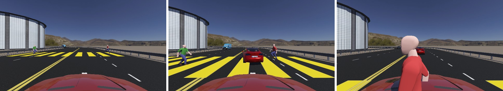
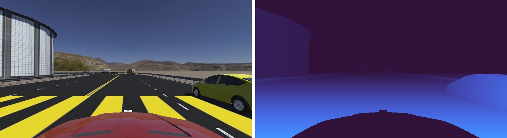
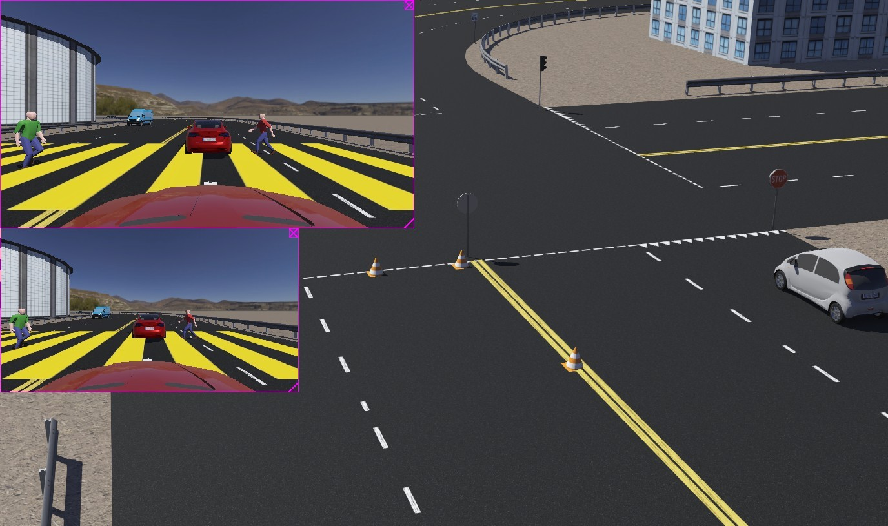
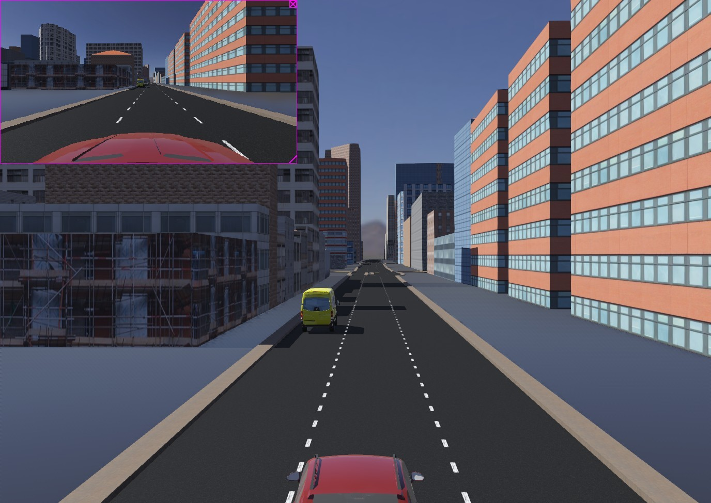
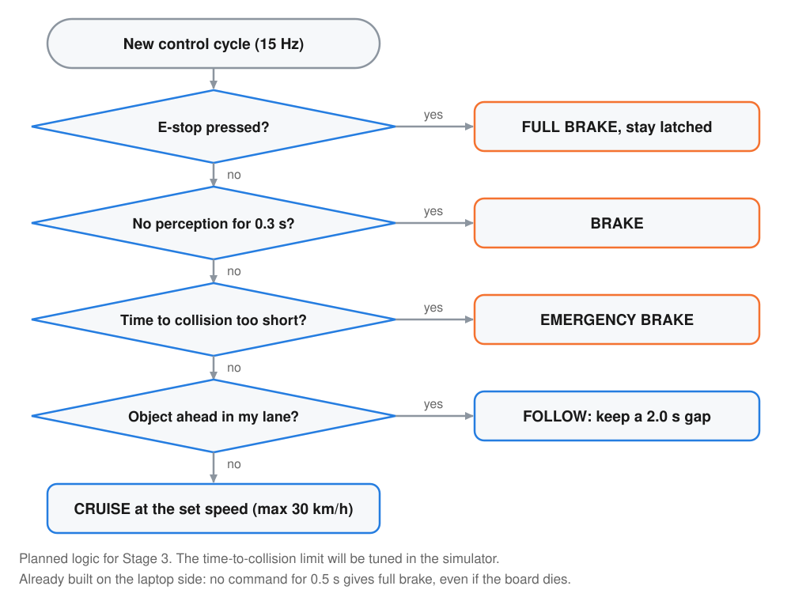

# Stage 2 Proposal: Stereo HIL, an RDK X5 that drives a simulated car and is scored against ground truth

## The demo, in one scene

The simulated car drives towards a zebra crossing at 20 km/h. A pedestrian steps onto the road. The RDK X5 sees the
person in the stereo pair, measures the distance on its own BPU and CPU, and brakes. The car stops short of the crossing,
and the report shows the stopping gap, the depth error at each distance and the time from image to brake command, all
checked against the simulator's exact positions.

## The problem

Testing a robot's perception on real roads is slow, unsafe and gives no ground truth: when a stereo camera says a
pedestrian is 7.4 m away, nobody knows the true distance. Most RDK X5 projects therefore show boxes on a screen and never
measure whether the depth or the braking decision was right.

## The concept

The RDK X5 runs its **real perception and control stack on its own BPU and CPU**, but its eyes are a simulated stereo
camera. A laptop runs Webots with SUMO traffic and sends the board a rendered stereo pair (same baseline and field of
view as the GS130W). The board sends back steering and speed. Because the simulator knows the exact depth of every pixel
and the exact position of every car and pedestrian, **every decision the board makes is scored automatically**: depth
error by range, stopping gap, collisions, latency.

The real GS130W stays in the loop for **real-world accuracy runs** (tape measure on 60 cm floor tiles), so the project
measures both sim-to-board and real-world performance with the same code.

## Operating scenario and constraints

| | |
|---|---|
| **Scenario** | Urban driving in two Webots worlds (city with a pedestrian crossing, San Francisco streets), daytime, dry roads, SUMO traffic (up to ~60 cars) and crossing pedestrians |
| **Vehicle limits** | Speed ≤ 30 km/h, steering ≤ 0.5 rad (clamped in the bridge); full brake if no command arrives for 0.5 s |
| **Compute** | All perception and decisions on the RDK X5 (4 GB, 3.0 GiB usable, one BPU shared by YOLO11m and StereoNet). The laptop only runs the simulator and scoring |
| **Camera model** | Stereo pair 640x352, 80 mm baseline, 96.8° horizontal field of view, ideal pinhole (no lens distortion or sensor noise in the simulator) |
| **Link** | ROS 2 over Wi-Fi 5 GHz (~150 Mbit/s for raw stereo at 14 Hz); direct Ethernet if Wi-Fi can't keep up |
| **Simulator speed** | 0.81–0.95x real time with traffic (measured); timing is measured in simulator time |
| **Real-world runs** | Indoors, GS130W on the stand, distances on 60 cm floor tiles (0.6–2.4 m) |
| **Safety** | Only the simulated car moves; e-stop topic on the board plus the bridge watchdog |

## The simulated world

Left camera frames from the city world (640x352): pedestrians step onto the crossing while traffic moves around the ego
car. Without the board in the loop, the scripted test car doesn't brake. In Stage 3 the board has to stop it.

The simulator also gives the exact depth of every pixel (right). It is used for scoring and never sent to the board.

| City world | San Francisco world |
|---|---|
|  |  |

## Users and interaction

| User | What they get |
|---|---|
| RDK developers and students | A safe test bench: run your own depth or detection node on the board and get a scored report, no car needed |
| Me (this challenge) | An ADAS-style stack (adaptive cruise + emergency braking) that is measured, not just demoed |
| D-Robotics ecosystem | A reproducible way to check StereoNet / YOLO accuracy on RDK hardware (see the open GS130W depth issues on the forum) |

Interaction: launch the sim on the laptop, launch the stack on the board, watch the car drive in Webots and the
board's view in the browser. A run ends with a report (`report.txt` + plots).

## Capabilities

| | What | Where |
|---|---|---|
| **Perception** | YOLO11m detection on the BPU; per-box stereo distance (Stage 1 node); StereoNet dense depth on the BPU | RDK X5 |
| **Decision** | Pick the nearest object in the ego lane; adaptive cruise (time gap) and emergency brake (time to collision) | RDK X5 CPU |
| **Actuation** | `ackermann_msgs/AckermannDriveStamped` to the simulated car, 15 Hz; speed ≤ 30 km/h, steer ≤ 0.5 rad | Sim car |
| **Safety** | Bridge watchdog: no command for 0.5 s → full brake (built and tested). Board e-stop topic, planner sanity limits | Both |
| **Scoring** | Depth vs pixel-exact ground truth (`check_depth.py`, built and self-tested); scenario scorer for stopping gap and collisions | Laptop |

## Innovation compared with a stock demo

| | Stock demo / prior art | This project |
|---|---|---|
| Stereo on RDK X5 | Depth image shown, accuracy unknown | Depth **scored per range bin** against exact sim ground truth, and against a tape in the real world |
| Closed loop | Detection only | Board **drives** a car in traffic; brake and follow decisions are scored |
| Prior HIL on RDK X5 | GaussianRPG v2.0 (Feb 2025): mono camera over HDMI capture, brake only, replayed scenes, no depth | **Stereo**, live SUMO traffic, steering + speed, **depth ground truth**, scoring tools |
| Fault finding | — | `check_depth.py` names the fault (wrong baseline/focal, cx offset, units, range vs planar Z, row shift) and caught all 6 injected faults in its self-test |

## Decision logic

<picture>
  <source media="(prefers-color-scheme: dark)" srcset="../figures/decision_flow_dark.svg">
  
</picture>

## Measurable success targets (Stage 3)

| # | Metric | Target | Baseline today | How measured |
|---|---|---|---|---|
| T1 | Depth error in sim, AbsRel vs ground truth | ≤ 3 % at 2–5 m, ≤ 8 % at 5–10 m | Checker built; board not run on sim yet | Board depth (per box and StereoNet) scored by `check_depth.py` against the simulator depth image; median AbsRel per range bin over 3 drives in each world |
| T2 | Real-world distance error (tape, floor tiles) | ≤ 3 % to 1.2 m, ≤ 6 % to 2.4 m | +1.5 % at 0.6 m (measured) | Object placed on tile lines at 0.6 / 1.2 / 1.8 / 2.4 m, 5 readings each, compared with the tape distance |
| T3 | Perception rate on the board for the sim stream | ≥ 10 Hz | 5–6 fps (Python, real camera) | Mean output rate from `/stereo_yolo/perf` over a 5-minute simulator run |
| T4 | Image-to-command latency (p95) | ≤ 150 ms | Frame age 224–236 ms today | Image timestamp to the time the bridge receives the matching command, in simulator time; 95th percentile over 5 minutes |
| T5 | Emergency brake for a crossing pedestrian | 10/10 runs stop with ≥ 2 m gap, 0 collisions | Scenario built (2 pedestrians on a zebra crossing) | 10 runs of the crossing scenario at 20 km/h; gap = car-to-pedestrian distance from simulator positions at standstill; any contact counts as a collision |
| T6 | Car following (adaptive cruise) | Time gap within ±20 % of 2.0 s after settling | — | SUMO lead car scenario; time gap = distance ÷ own speed from simulator positions, after 10 s settling, over 60 s |
| T7 | Two concurrent BPU workloads | YOLO11m + StereoNet both ≥ 10 Hz | YOLO11m 40.5 ms alone (BPU) | Both nodes running at once; output rate of each with `ros2 topic hz`, BPU load with `hrut_somstatus` |

Stretch: lane keeping from the board's own perception (lateral control is fixed to the route until then).
